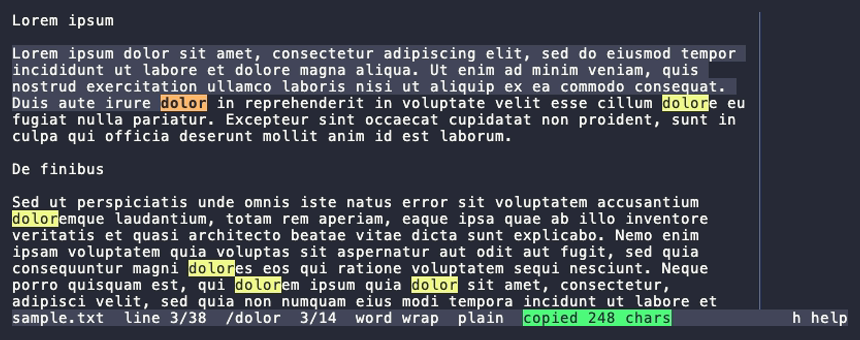
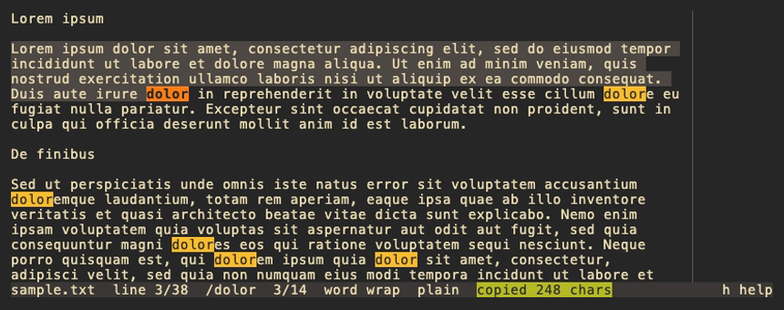
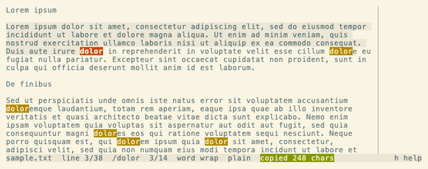

# Themes

The themes vedi ships, each in a terminal with the background its file names;
`mono` in a plain dark one. To use one, see
[Colors](configuration.md#colors).

## catppuccin-latte

## catppuccin-mocha

## dracula

## gruvbox-dark

## mono

## nord

## solarized-dark

## solarized-light

