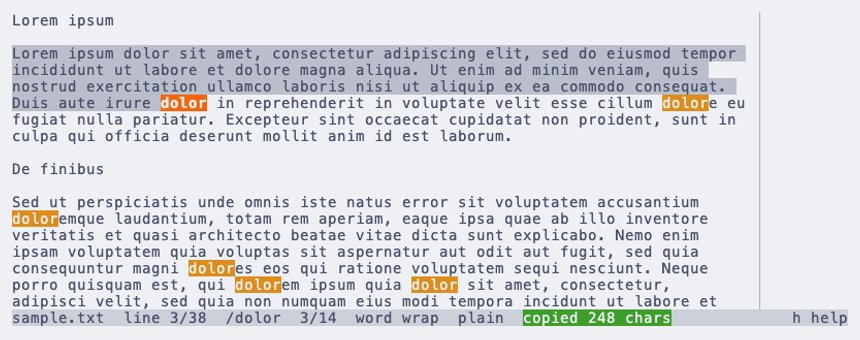
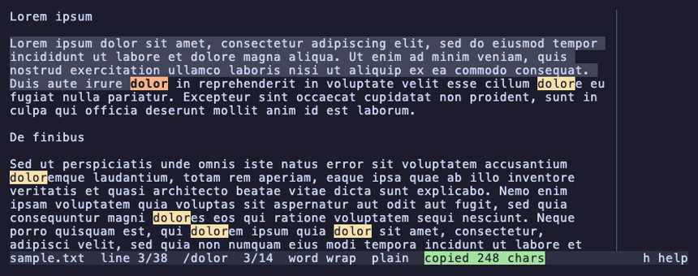
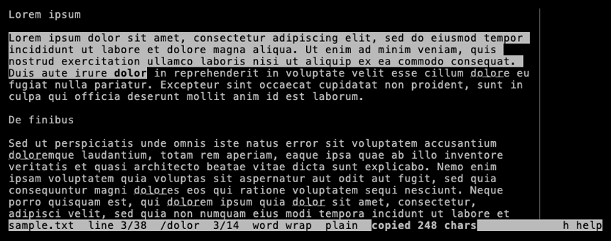
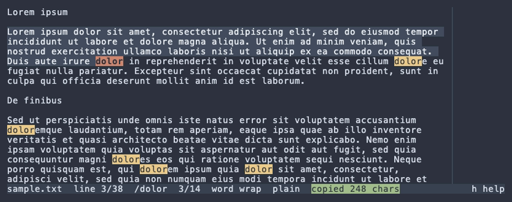
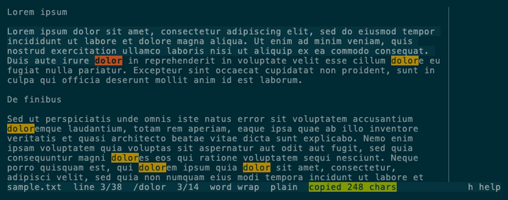

# Themes

The themes vedi ships, each in a terminal with the background its file names;
`mono` in a plain dark one.

To use one, `include` its file in `vedi.conf`; see
[Themes](configuration.md#themes).

## catppuccin-latte

`catppuccin-latte.conf`

## catppuccin-mocha

`catppuccin-mocha.conf`

## dracula

`dracula.conf`

## gruvbox-dark

`gruvbox-dark.conf`

## mono

`mono.conf`

## nord

`nord.conf`

## solarized-dark

`solarized-dark.conf`

## solarized-light

`solarized-light.conf`

